<!-- Generated by scripts/build-profile.mjs from the portfolio catalogue. -->
<picture>
  <source media="(max-width: 600px) and (prefers-color-scheme: dark)" srcset="assets/generated/hero-mobile-dark.svg">
  <source media="(max-width: 600px)" srcset="assets/generated/hero-mobile-light.svg">
  <source media="(prefers-color-scheme: dark)" srcset="assets/generated/hero-dark.svg">
  
</picture>

<a href="https://priyanshu-hai.vercel.app"><picture>
  <source media="(prefers-color-scheme: dark)" srcset="assets/generated/portfolio-dark.svg">
  
</picture></a>
<a href="https://www.linkedin.com/in/priyanshu-chaurasia-326979335/"><picture>
  <source media="(prefers-color-scheme: dark)" srcset="assets/generated/linkedin-dark.svg">
  
</picture></a>
<a href="mailto:priyanshuchaurasiadlw@gmail.com"><picture>
  <source media="(prefers-color-scheme: dark)" srcset="assets/generated/email-dark.svg">
  
</picture></a>
<a href="https://priyanshu-hai.vercel.app/resume.pdf"><picture>
  <source media="(prefers-color-scheme: dark)" srcset="assets/generated/resume-dark.svg">
  
</picture></a>

  <a href="#selected-work">Selected work</a> &nbsp; / &nbsp; <a href="#toolbox">Toolbox</a> &nbsp; / &nbsp; <a href="#live-activity">Live activity</a> &nbsp; / &nbsp; <a href="#the-story-so-far">My story</a>

## I build the systems institutions run on.

I'm **Priyanshu Chaurasia**, a third-year **Computer Science & Engineering student at MMMUT, Gorakhpur (2024–2028)**. I build developer tools, campus infrastructure and operational software — from native Rust terminals to the systems behind two startups.

I like starting with an architecture diagram and staying until people can use what I build.

> **Open to internships and SDE roles.** Interested in developer experience, full-stack engineering and applied AI? [Let's talk ↗](mailto:priyanshuchaurasiadlw@gmail.com)

### Currently building & leading

| Where | What I do |
| :--- | :--- |
| 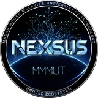 **[Nexsus](https://mmmut.app)** | **Founder & President** · A registered campus society and a shared digital ecosystem. Five web portals, two mobile apps, five RAG assistants; the CSE department uses its timetable. |
|  **[Gryork](https://www.gryork.com)** | **CTO** · Architecture for a bill-discounting marketplace connecting EPCs, subcontractors and NBFCs. |
|  **[Washtro](https://www.washtro.com)** | **CTO** · Garment-level tracking, custody trails and operations for a laundry chain. |
| 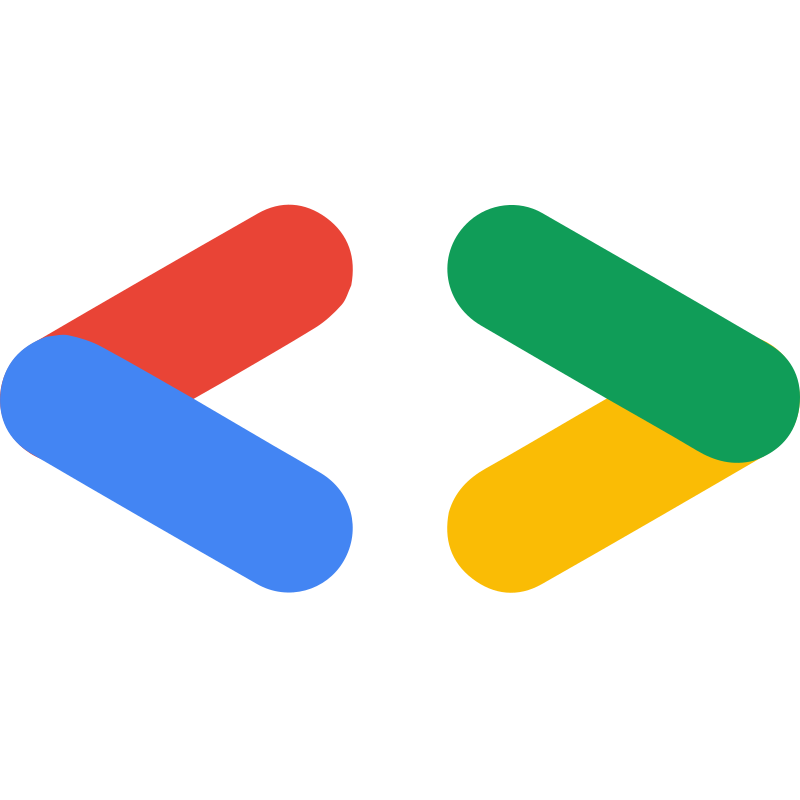 **[GDG on Campus, MMMUT](https://gdg.mmmut.app)** | **Organiser & Campus Lead · September 2026–present.** Previously Executive Member; built the chapter website and its induction system. |

### A few things that reached the real world

- **National winner**, Upskill India Challenge at **IIT Bombay Techfest ’25** — Cognito Learning Hub, a twelve-service learning platform.
- **₹2.5 lakh grant** awarded to Gryork on the technical architecture I designed, at **IIIT Allahabad**.
- **200+ admissions into MMMUT** through Nexsus counselling, with 900 students reached and 450 mentorship sessions.
- **85+ students taught** agentic AI and full-stack development through Gryork Techpreneur 2026.

## Selected work

<picture>
  <source media="(prefers-color-scheme: dark)" srcset="assets/generated/work-dark.svg">
  
</picture>

Two developer tools up front. Open the other projects to see their screenshots, stack and case studies.

### 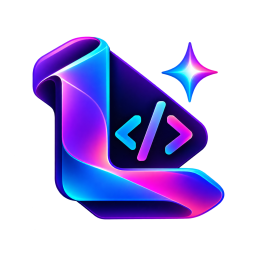 01 / Little Code

<a href="https://priyanshu-hai.vercel.app/projects/little-code">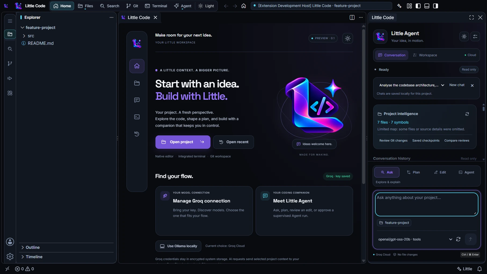</a>

An AI coding companion inside its own Code-OSS desktop app. Ask, plan, review edits and run supervised agents in the workspace — with local project memory, MCP tools and cloud or local models.

**Built with:** TypeScript · Electron · Code-OSS · React · Groq · Ollama

[Case study ↗](https://priyanshu-hai.vercel.app/projects/little-code) · [Visit website ↗](https://little-code.vercel.app/) · [Source ↗](https://github.com/priyanshu-1006/Little_Code)

###  02 / Little Terminal

<a href="https://priyanshu-hai.vercel.app/projects/little-terminal">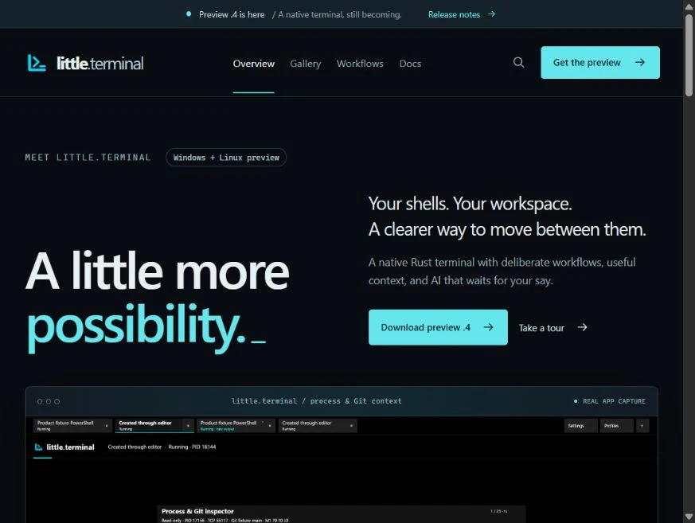</a>

A native Rust terminal with GPU rendering and real Windows ConPTY sessions. Split workspaces, manage services and review AI actions in a terminal built around an actual shell.

**Built with:** Rust · wgpu · winit · ConPTY · Tokio · SQLite

[Case study ↗](https://priyanshu-hai.vercel.app/projects/little-terminal) · [Visit website ↗](https://little-terminal.vercel.app/)

<strong>03 / Nexsus</strong> · React / TypeScript

<a href="https://priyanshu-hai.vercel.app/projects/nexsus-universe">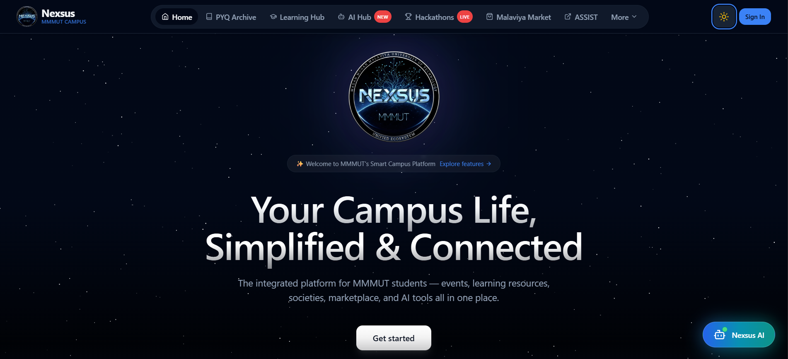</a>

A unified digital ecosystem for the MMMUT campus — five portals, two mobile apps and five RAG-backed assistants on one backend. The CSE department now runs its live timetable on it.

**Built with:** React · TypeScript · Express · Prisma · PostgreSQL · pgvector

[Case study ↗](https://priyanshu-hai.vercel.app/projects/nexsus-universe) · [Visit website ↗](https://mmmut.app)

<strong>04 / Cognito Learning Hub</strong> · React / Node.js

<a href="https://priyanshu-hai.vercel.app/projects/cognito-learning-hub">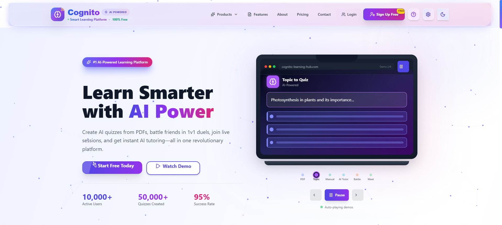</a>

A twelve-service AI learning platform with live multiplayer quizzes — national winner of the Upskill India Challenge at IIT Bombay Techfest ’25.

**Built with:** React · Node.js · Express · MongoDB Atlas · Redis · Socket.IO

[Case study ↗](https://priyanshu-hai.vercel.app/projects/cognito-learning-hub) · [Visit website ↗](https://cognito-learning-hub.vercel.app) · [Source ↗](https://github.com/amitesh-7/Cognito_Learning_Hub)

<strong>05 / FractureVision AI</strong> · PyTorch / timm

<a href="https://priyanshu-hai.vercel.app/projects/fracturevision-ai">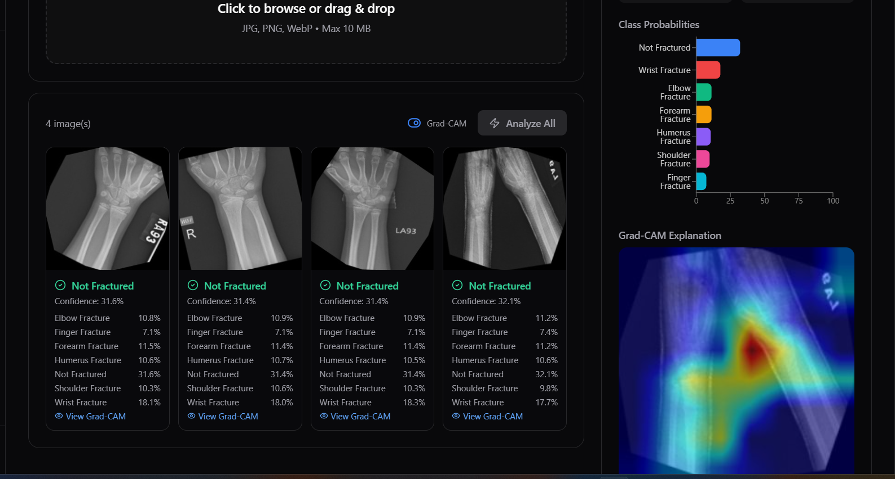</a>

Three complementary models for fracture classification and localisation, with Grad-CAM explanations. Built and evaluated as a research prototype; fifth place and special mention at Xpecto ’26, IIT Mandi.

**Built with:** PyTorch · timm · Ultralytics · ViT-Base/16 · YOLOv10n · Grad-CAM

[Case study ↗](https://priyanshu-hai.vercel.app/projects/fracturevision-ai)

<strong>06 / Nexsus Assist</strong> · Next.js 15 / TypeScript

<a href="https://priyanshu-hai.vercel.app/projects/nexsus-assist">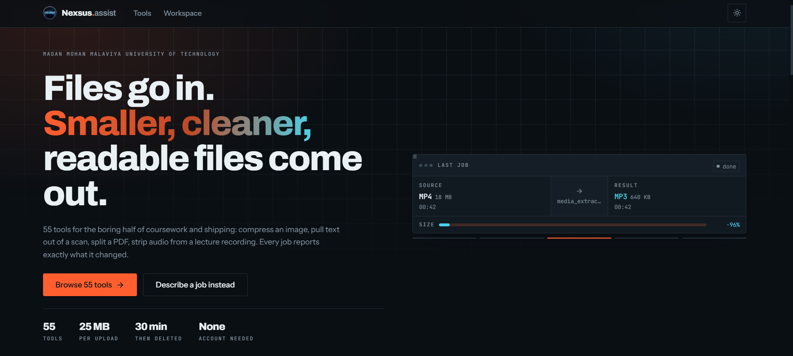</a>

Fifty-five file and developer utilities behind a chat interface that routes your request to the right one.

**Built with:** Next.js 15 · TypeScript · FastAPI · Python · Groq · Claude

[Case study ↗](https://priyanshu-hai.vercel.app/projects/nexsus-assist)

<strong>07 / Haazir</strong> · React / TypeScript

<a href="https://priyanshu-hai.vercel.app/projects/haazir">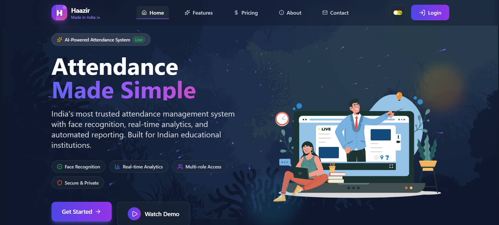</a>

Attendance that survives contact with students — cryptographic QR, ArcFace biometrics and geo-fencing — plus the CSP solver that now timetables an entire department.

**Built with:** React · TypeScript · Node.js · Express · Prisma · PostgreSQL

[Case study ↗](https://priyanshu-hai.vercel.app/projects/haazir) · [Visit website ↗](https://haazir-six.vercel.app) · [Source ↗](https://github.com/priyanshu-1006/Haazir-Smart-Attendence-Management-System)

<strong>08 / Washtro</strong> · NestJS / TypeScript

<a href="https://priyanshu-hai.vercel.app/projects/washtro">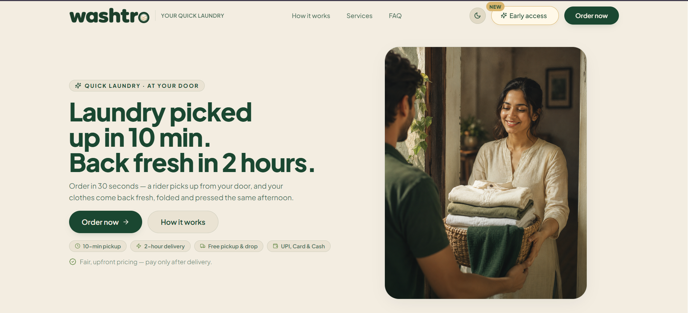</a>

Garment-level chain of custody for a laundry chain — every individual item tracked, timestamped and provable.

**Built with:** NestJS · TypeScript · Prisma · PostgreSQL · Redis · Next.js

[Case study ↗](https://priyanshu-hai.vercel.app/projects/washtro) · [Visit website ↗](https://www.washtro.com)

<strong>09 / Washing Bro</strong> · Express / TypeScript

<a href="https://priyanshu-hai.vercel.app/projects/washing-bro">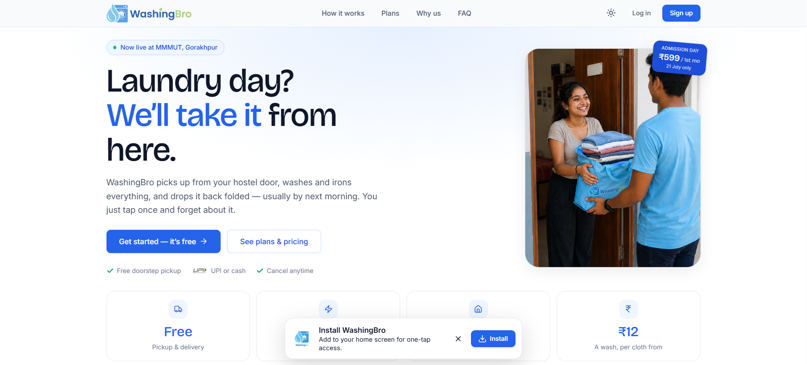</a>

Laundry-as-a-service for the MMMUT campus — four web surfaces, a Flutter app, subscriptions and a referral wallet.

**Built with:** Express · TypeScript · Prisma · PostgreSQL · Supabase · React

[Case study ↗](https://priyanshu-hai.vercel.app/projects/washing-bro)

<strong>10 / AuroraHai</strong> · Python / FastAPI

<a href="https://priyanshu-hai.vercel.app/projects/aurorahai">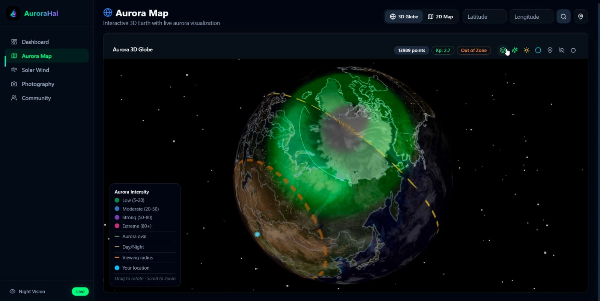</a>

Hyper-local aurora forecasting — space weather telemetry joined to local sky conditions, for photographers.

**Built with:** Python · FastAPI · Pydantic V2 · React · TypeScript · Vite

[Case study ↗](https://priyanshu-hai.vercel.app/projects/aurorahai)

<strong>More from the workshop — 15 projects</strong>

Campus tools, evidence-led AI prototypes, startup systems and the earlier projects that shaped how I build. Team projects are described in their linked case studies.

| Project | What it does | Explore |
| :--- | :--- | :--- |
| [MMMUT Notice](https://priyanshu-hai.vercel.app/projects/mmmut-notice) | Official university notices turned into reviewed student updates: source monitoring, PDF/OCR extraction, AI drafting, email subscriptions and Nexsus sync. | [Case study ↗](https://priyanshu-hai.vercel.app/projects/mmmut-notice) |
| [ManakMitra](https://priyanshu-hai.vercel.app/projects/manakmitra) | Evidence-grounded Indian Standards discovery: cited answers, deterministic certification checks, lab search and a traceable compliance workspace. | [Website ↗](https://manakmitra.me) |
| [SatyaDwar](https://priyanshu-hai.vercel.app/projects/satyadwar) | An offline-first identity-document screening prototype with signed-QR verification, OCR comparisons, itemised evidence and an installable checkpoint node. | [Case study ↗](https://priyanshu-hai.vercel.app/projects/satyadwar) |
| [Nexsus Counselling Support](https://priyanshu-hai.vercel.app/projects/nexsus-counselling) | Admission counselling for UP state engineering aspirants. 900 students used it, 450 took mentorship, 200+ got into MMMUT. | [Website ↗](https://counselling.mmmut.app) |
| [Gryork](https://priyanshu-hai.vercel.app/projects/gryork) | A bill-discounting marketplace giving infrastructure sub-contractors liquidity on unpaid receivables. The architecture won a ₹2.5 lakh grant. | [Website ↗](https://www.gryork.com) |
| [Vigilant-Bhai](https://priyanshu-hai.vercel.app/projects/vigilant-bhai) | Fraud detection that does not stop at "is this a scam" — it traces where the scam started and predicts where it spreads next. | [Case study ↗](https://priyanshu-hai.vercel.app/projects/vigilant-bhai) |
| [Anand Pumps](https://priyanshu-hai.vercel.app/projects/anand-pumps) | A commercial e-commerce storefront for an ISI-certified water pump manufacturer — catalogue, cart and quote flow. | [Case study ↗](https://priyanshu-hai.vercel.app/projects/anand-pumps) |
| [PathFinder AI](https://priyanshu-hai.vercel.app/projects/pathfinder-ai) | A career and skills advisor that turns a student profile into a concrete, trackable learning roadmap for the Indian job market. | [Case study ↗](https://priyanshu-hai.vercel.app/projects/pathfinder-ai) |
| [FinAgent](https://priyanshu-hai.vercel.app/projects/finagent-ai) | An agent that executes financial tasks by driving a real browser — and stops to ask before it commits anything. | [Case study ↗](https://priyanshu-hai.vercel.app/projects/finagent-ai) |
| [MediChain AI](https://priyanshu-hai.vercel.app/projects/medichain-ai) | Federated learning across hospitals with blockchain-verified model provenance — patient data never leaves the building. | [Case study ↗](https://priyanshu-hai.vercel.app/projects/medichain-ai) |
| [Gryork Techpreneur 2026](https://priyanshu-hai.vercel.app/projects/gryork-techpreneur) | A four-week industrial programme I built the platform for and taught — 85+ students, at ₹1,200 a seat. | [Website ↗](https://training.gryork.com) |
| [GDG on Campus — MMMUT](https://priyanshu-hai.vercel.app/projects/gdg-mmmut) | The chapter’s web presence, plus an induction system that processed 250+ applicants end to end. | [Website ↗](https://gdg.mmmut.app) |
| [MMMUT Faculty Development Programme](https://priyanshu-hai.vercel.app/projects/mmmut-fdp) | Pages on the university’s official website — my code running on mmmut.ac.in. | [Website ↗](https://mmmut.ac.in/primeai) |
| [QuizWise AI](https://priyanshu-hai.vercel.app/projects/quizwise-ai) | An AI quiz platform built for my mother, a school teacher. Point it at a topic or a PDF and it writes the paper. The project where I stopped building screens and started building systems. | [Case study ↗](https://priyanshu-hai.vercel.app/projects/quizwise-ai) |
| [BookEase](https://priyanshu-hai.vercel.app/projects/bookease) | A MERN appointment booking system, built and shipped during a four-week internship. | [Website ↗](https://bookease-client.vercel.app/) |

### ManakMitra & SatyaDwar

<a href="https://priyanshu-hai.vercel.app/projects/manakmitra">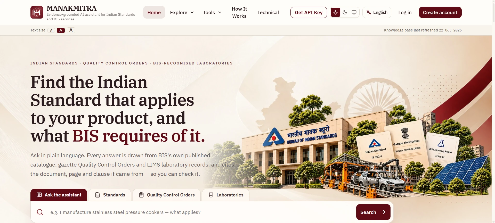</a>

**ManakMitra:** Evidence-grounded Indian Standards discovery, certification checks and laboratory search. [Case study ↗](https://priyanshu-hai.vercel.app/projects/manakmitra) · [Website ↗](https://manakmitra.me)

<a href="https://priyanshu-hai.vercel.app/projects/satyadwar">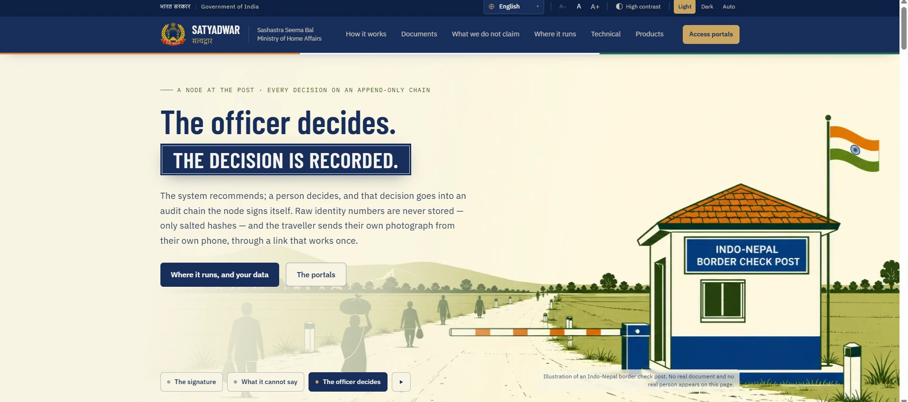</a>

**SatyaDwar:** Offline-first document screening with signed-QR verification, OCR comparisons and itemised evidence. [Case study ↗](https://priyanshu-hai.vercel.app/projects/satyadwar)

<strong>Explore Priyanshu OS — this profile, as an interactive computer</strong>

<a href="https://priyanshu-hai.vercel.app">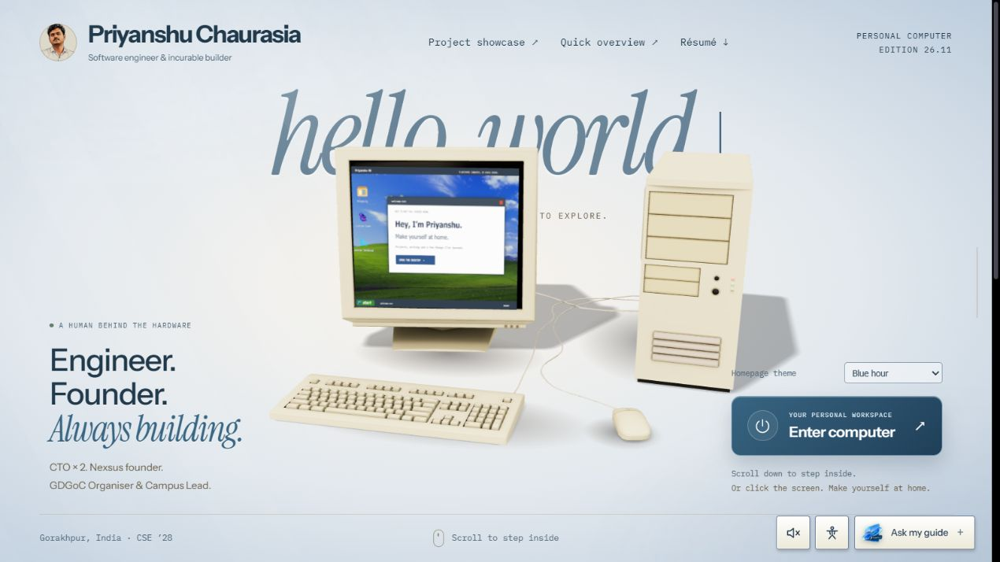</a>

A 3D computer you can enter, an XP-inspired desktop, a searchable project library, a working terminal, a calendar and a question-based guide. Built with **React, Three.js and Vite**.

[Enter the computer ↗](https://priyanshu-hai.vercel.app) · [Browse all case studies ↗](https://priyanshu-hai.vercel.app/projects)

## Toolbox

 &nbsp;  &nbsp;  &nbsp;  &nbsp;  &nbsp;  &nbsp; 

 &nbsp;  &nbsp;  &nbsp;  &nbsp; 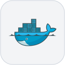 &nbsp;  &nbsp; 

| Layer | Tools I use |
| :--- | :--- |
| **Languages** | TypeScript · JavaScript · Python · Rust · Java · C++ · SQL |
| **Interfaces** | React · Next.js · React Native / Expo · Tailwind CSS · Vite |
| **Services & data** | Node.js · Express · NestJS · FastAPI · Prisma · PostgreSQL · MongoDB · Redis |
| **Applied AI** | RAG · LangChain · LangGraph · pgvector · PyTorch · vision transformers · YOLO · Grad-CAM |
| **Shipping** | Docker · Vercel · Railway · Render · Turborepo · Playwright · Git |

<strong>How those tools connect</strong>

1. **Start with the workflow.** Who uses it, and which state transitions must be trusted?
2. **Design the data and boundaries.** Permissions, append-only audit trails, validation and failure paths come before extra screens.
3. **Build the interface and the service together.** Browser, mobile or native, depending on the job.
4. **Add AI where the evidence supports it.** Retrieval with citations, reviewed actions and model explanations.
5. **Ship, observe, improve.** The department timetable and startup operations make the feedback loop very real.

## Live activity

  
  
  
  

  
  

Live images refresh through their providers' caches. Contribution and repository badges read the portfolio's daily snapshot. The calendar can include private contribution counts; public code links show only public work.

<strong>Open the saved build log & public commit snapshot</strong>

<picture>
  <source media="(prefers-color-scheme: dark)" srcset="assets/generated/activity-dark.svg">
  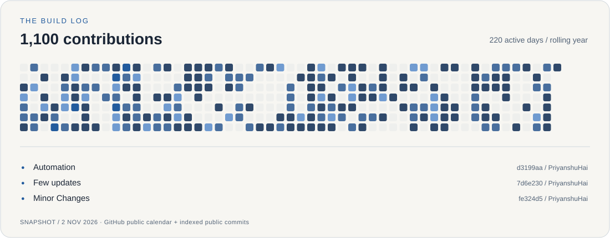
</picture>

- [`d3199aa`](https://github.com/priyanshu-1006/PriyanshuHai/commit/d3199aa38889584787877c98df546d0284ed26bc) · **PriyanshuHai** · Automation
- [`7d6e230`](https://github.com/priyanshu-1006/PriyanshuHai/commit/7d6e23045d6aafc2f3c5ce6dd261d31d3c919bf2) · **PriyanshuHai** · Few updates
- [`fe324d5`](https://github.com/priyanshu-1006/PriyanshuHai/commit/fe324d5450b3b6e2e6c1334d19d908442f622273) · **PriyanshuHai** · Minor Changes

This backup is stored in the repository and works independently of the live-image services. [How it refreshes](docs/profile-maintenance.md).

## The story so far

| When | The next thing I built |
| :--- | :--- |
| **2024** | Joined MMMUT for B.Tech CSE. Managed mess operations for a 300+ student hostel in first year. |
| **2025** | Shipped BookEase during an internship. Became CTO at Gryork. Built Haazir; started Nexsus in November. Won the Upskill India Challenge at IIT Bombay Techfest in December. |
| **2026** | Nexsus became a registered university society. Took on Washtro's architecture; taught the Gryork Techpreneur programme. Became **GDGoC Organiser & Campus Lead in September**. Built Little Code and Little Terminal. |
| **Now** | Building developer tools and maintaining platforms that real students, teams and businesses rely on. |

<strong>A project that changed how I think</strong>

**QuizWise AI started with my mother, a school teacher.** I wanted a tool that could turn a topic or PDF into a question paper. It pushed me beyond building screens and into designing a complete workflow: extraction, generation, review and delivery.

That thread runs through the rest of my work — find an everyday problem, understand the people around it, and build the system all the way through.

[Read “The Architecture of an Idea” ↗](https://priyanshu-hai.vercel.app/The_Architecture_Of_An_Idea.pdf)

## Let's build something useful.

For internships, SDE opportunities, developer tools or an interesting systems problem:

   &nbsp; <a href="https://www.linkedin.com/in/priyanshu-chaurasia-326979335/">LinkedIn</a> &nbsp; / &nbsp;
  <a href="mailto:priyanshuchaurasiadlw@gmail.com">Email</a> &nbsp; / &nbsp;
   &nbsp; <a href="https://www.instagram.com/_priyanshu.10_/">Instagram</a> &nbsp; / &nbsp;
  <a href="https://priyanshu-hai.vercel.app">Portfolio</a>

Built with care in Gorakhpur. Source, screenshots and the systems behind the story are one click away.
